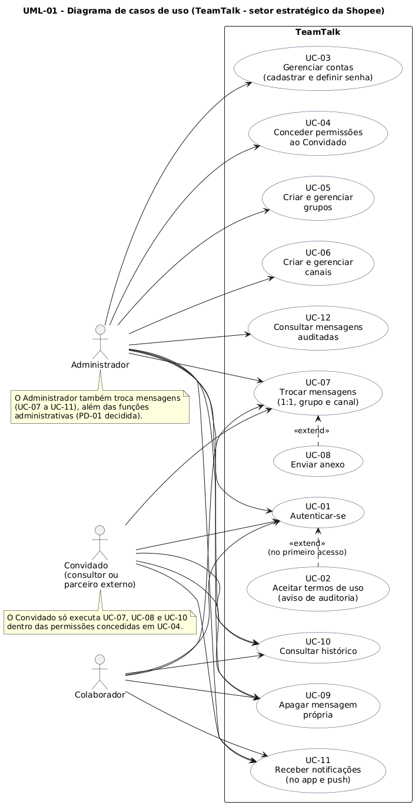
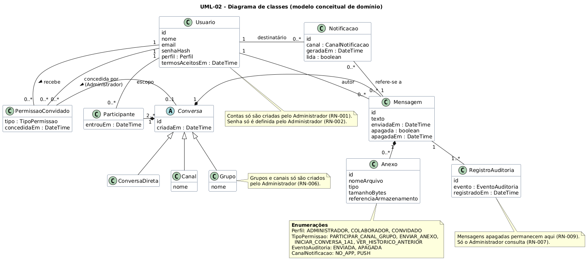
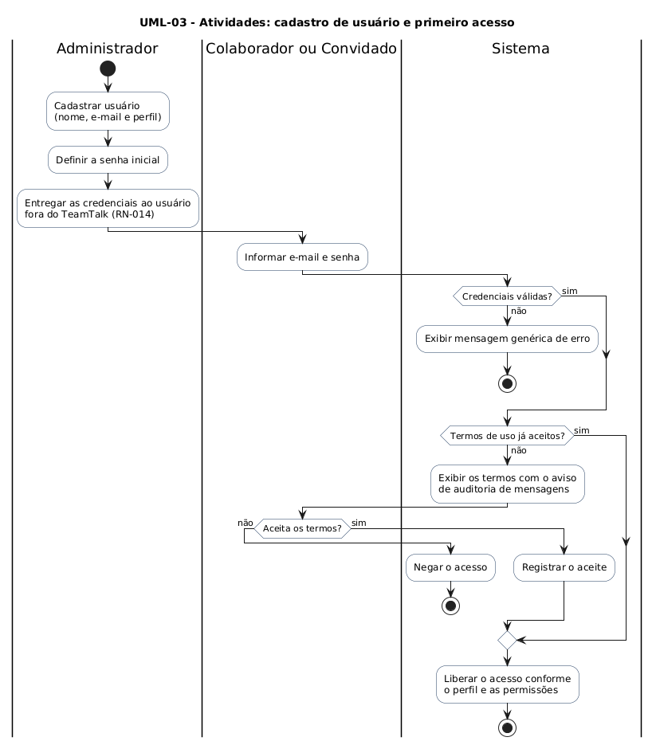
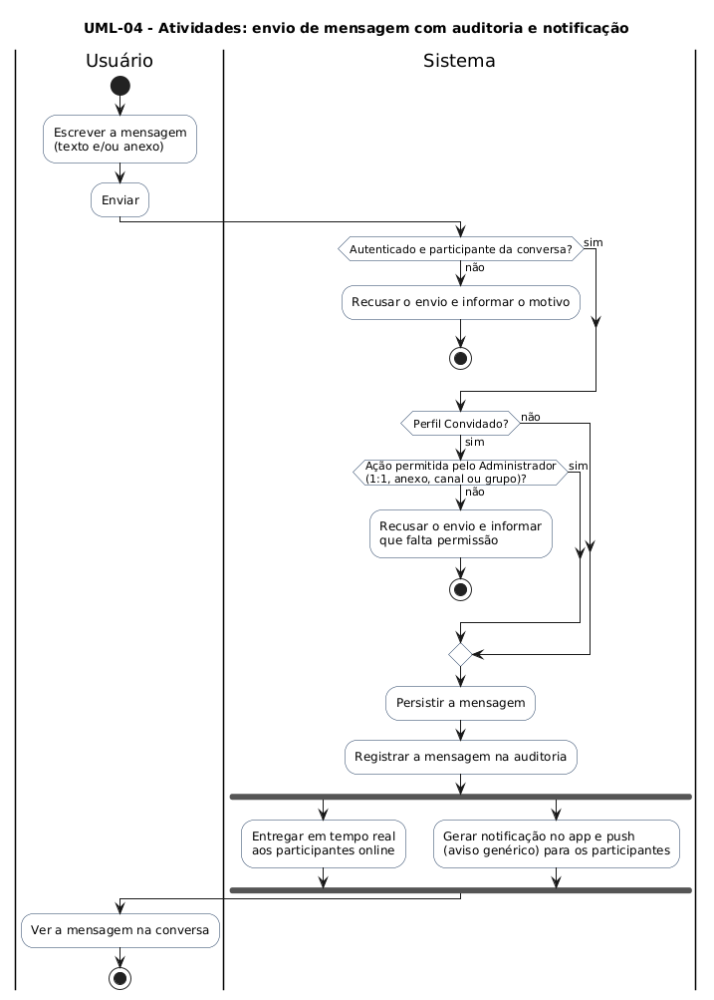
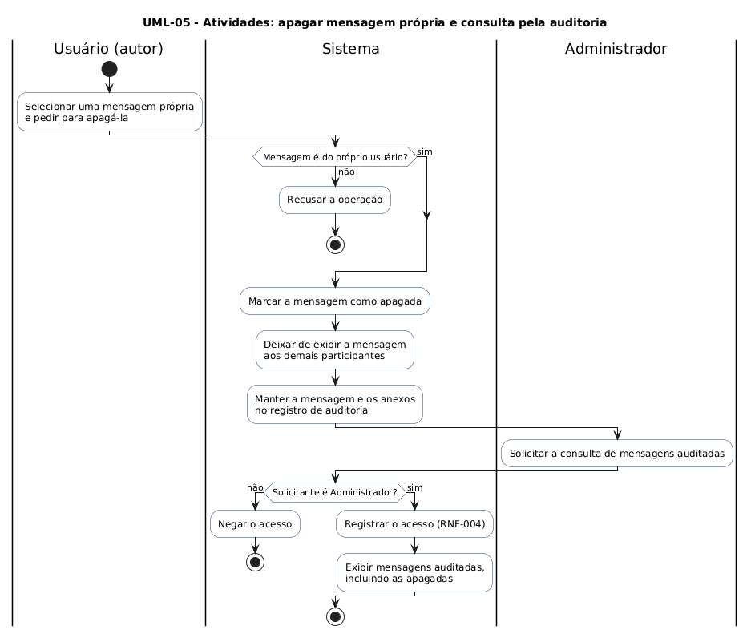
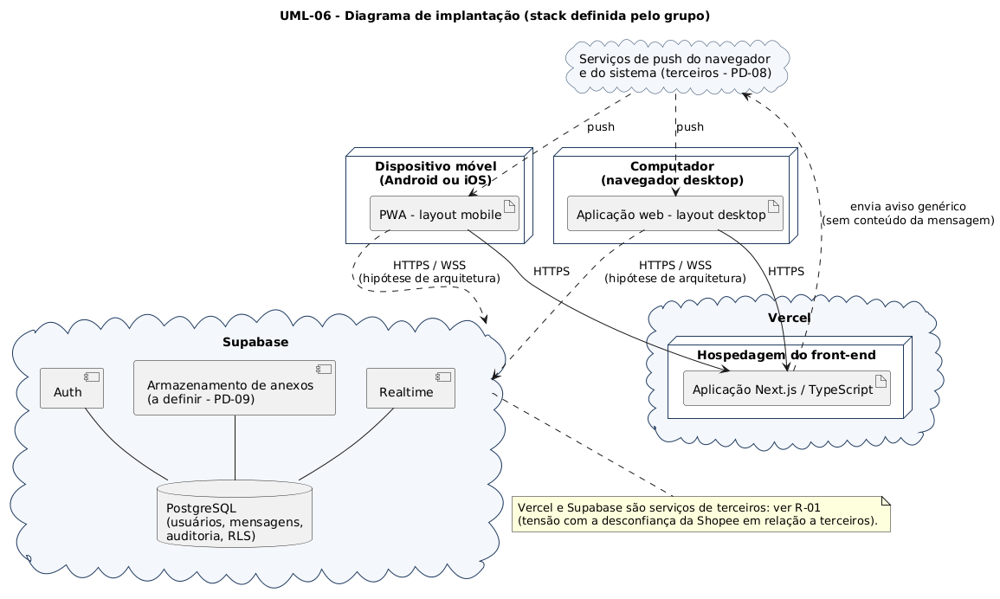

# 6. Diagramas UML

Voltar ao [controle do documento](00-controle-do-documento.md). Requisitos relacionados em [Requisitos funcionais](03-requisitos-funcionais.md) e regras em [Regras de negócio e restrições](05-regras-de-negocio-e-restricoes.md).

## 6.1 Tipos de diagrama e ferramenta

Os tipos foram escolhidos por Arthur Fonseca: **casos de uso, classes, atividades e implantação**. Nenhum outro tipo foi produzido.

- **Formato e ferramenta:** PlantUML (versão 1.2026.10), com o código-fonte editável em cada seção abaixo e em arquivos `.puml`.
- **Imagens renderizadas:** arquivos PNG em [diagramas](diagramas/). O GitHub não renderiza PlantUML por conta própria, por isso as imagens ficam versionadas junto com o código.
- **Como regenerar:** `java -jar plantuml.jar -charset UTF-8 -tpng -SDpi=140 -o .. docs/diagramas/src/<arquivo>.puml`.
- **Estado dos diagramas:** os diagramas correspondem ao escopo desta versão (0.6). Itens ainda em aberto aparecem com `PD-xx` dentro das figuras.

| Diagrama | Arquivo da imagem | Arquivo-fonte |
| --- | --- | --- |
| UML-01 Diagrama de casos de uso | [uml-01-casos-de-uso.png](diagramas/uml-01-casos-de-uso.png) | [uml-01-casos-de-uso.puml](diagramas/src/uml-01-casos-de-uso.puml) |
| UML-02 Diagrama de classes | [uml-02-classes.png](diagramas/uml-02-classes.png) | [uml-02-classes.puml](diagramas/src/uml-02-classes.puml) |
| UML-03 Atividades: cadastro de usuário e primeiro acesso | [uml-03-atividades-cadastro-primeiro-acesso.png](diagramas/uml-03-atividades-cadastro-primeiro-acesso.png) | [uml-03-atividades-cadastro-primeiro-acesso.puml](diagramas/src/uml-03-atividades-cadastro-primeiro-acesso.puml) |
| UML-04 Atividades: envio de mensagem | [uml-04-atividades-envio-mensagem.png](diagramas/uml-04-atividades-envio-mensagem.png) | [uml-04-atividades-envio-mensagem.puml](diagramas/src/uml-04-atividades-envio-mensagem.puml) |
| UML-05 Atividades: apagar mensagem e consulta pela auditoria | [uml-05-atividades-apagar-e-auditar.png](diagramas/uml-05-atividades-apagar-e-auditar.png) | [uml-05-atividades-apagar-e-auditar.puml](diagramas/src/uml-05-atividades-apagar-e-auditar.puml) |
| UML-06 Diagrama de implantação | [uml-06-implantacao.png](diagramas/uml-06-implantacao.png) | [uml-06-implantacao.puml](diagramas/src/uml-06-implantacao.puml) |

## 6.2 UML-01 Diagrama de casos de uso

- **Finalidade:** Mostrar quem faz o quê no TeamTalk e como as permissões do Convidado limitam as ações. O Administrador também troca mensagens.
- **Elementos principais:** Atores Administrador, Colaborador e Convidado. Casos de uso UC-01 a UC-12, com extensão de UC-02 sobre UC-01 e de UC-08 sobre UC-07.
- **Requisitos relacionados:** RF-001 a RF-018 (RF-006 retirado), RN-001 a RN-009.

Código-fonte (PlantUML)

## 6.3 UML-02 Diagrama de classes

- **Finalidade:** Representar o modelo conceitual de domínio: usuários, permissões, conversas, mensagens, anexos, auditoria e notificações. Não é o modelo físico do banco.
- **Elementos principais:** Usuario, PermissaoConvidado, Conversa (ConversaDireta, Grupo, Canal), Participante, Mensagem, Anexo, RegistroAuditoria, Notificacao e enumerações Perfil, TipoPermissao, EventoAuditoria e CanalNotificacao.
- **Requisitos relacionados:** RF-001, RF-003, RF-007 a RF-018, RN-001 a RN-009.

Código-fonte (PlantUML)

## 6.4 UML-03 Atividades: cadastro de usuário e primeiro acesso

- **Finalidade:** Descrever o caminho do cadastro pelo Administrador até o primeiro acesso, com aceite dos termos.
- **Elementos principais:** Raias Administrador, Colaborador ou Convidado e Sistema. Decisões sobre credenciais, aceite prévio e aceite dos termos.
- **Requisitos relacionados:** RF-001, RF-002, RF-004, RF-005, RN-001 a RN-003, RN-014.

Código-fonte (PlantUML)

## 6.5 UML-04 Atividades: envio de mensagem

- **Finalidade:** Descrever o envio de uma mensagem, com checagem de permissão do Convidado, auditoria, entrega em tempo real e notificação.
- **Elementos principais:** Raias Usuário e Sistema. Decisões de autorização e permissão, atividades paralelas de entrega e notificação.
- **Requisitos relacionados:** RF-008, RF-012, RF-013, RF-015, RF-016, RF-017, RN-004, RN-005, RN-008.

Código-fonte (PlantUML)

## 6.6 UML-05 Atividades: apagar mensagem e consulta pela auditoria

- **Finalidade:** Descrever o que ocorre quando um usuário apaga uma mensagem e como o Administrador a consulta depois, com o acesso registrado.
- **Elementos principais:** Raias Usuário (autor), Sistema e Administrador. Decisões de autoria e de perfil do solicitante.
- **Requisitos relacionados:** RF-014, RF-017, RF-018, RN-007 a RN-009, RNF-004.

Código-fonte (PlantUML)

## 6.7 UML-06 Diagrama de implantação

- **Finalidade:** Mostrar onde cada parte do sistema roda, na stack definida pelo grupo, e quais dependências de terceiros existem.
- **Elementos principais:** Dispositivo móvel (PWA), computador (aplicação web), Vercel (front-end Next.js), Supabase (PostgreSQL, Auth, Realtime, armazenamento de anexos) e serviços de push do navegador e do sistema. O armazenamento de anexos está em aberto (PD-09). A comunicação entre o front-end e o Supabase é hipótese de arquitetura.
- **Requisitos relacionados:** RS-001, RS-002, RNF-002, RNF-003, RNF-009, RNF-010, R-01, R-02.

Código-fonte (PlantUML)

